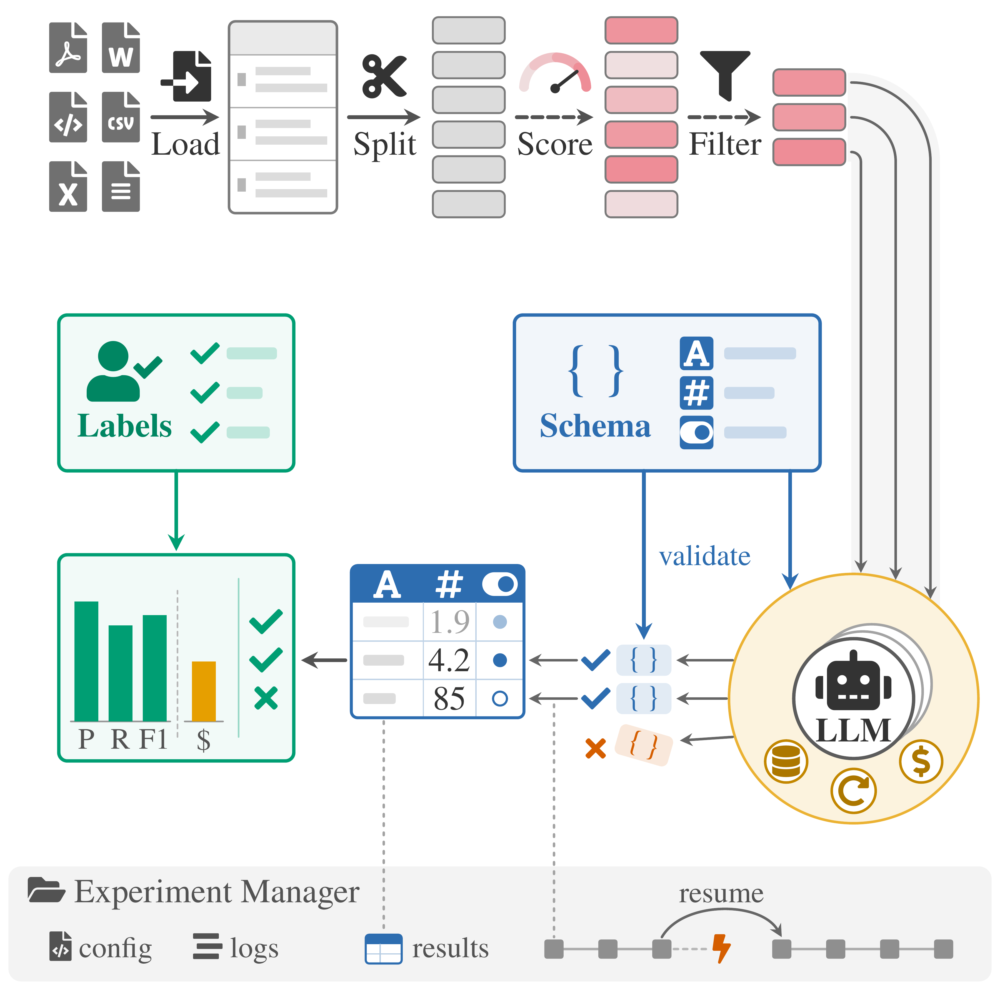

# DELM

**Data Extraction with Language Models** – A Python toolkit for extracting structured data from unstructured text using LLMs.

<figure style="text-align: center;">
  <video autoplay loop muted playsinline preload="auto" width="640" poster="assets/delm_pipeline_poster.jpg" style="max-width: 100%; height: auto; border-radius: 8px;" aria-label="Animated DELM pipeline: documents are loaded, split into chunks, scored and filtered for relevance, then sent to an LLM whose outputs are validated against a schema, collected into a table, and evaluated against labels. An experiment manager tracks config, logs, and results so runs can resume after interruption.">
    <source src="assets/delm_pipeline.mp4" type="video/mp4" />
    
  </video>
  <figcaption>Load → split → score → filter → extract with schema validation → evaluate, all checkpointed so interrupted runs resume where they stopped.</figcaption>
</figure>

## Why DELM?

Extracting structured data from documents at scale is harder than it should be. You need consistent prompts, validation logic, retry handling, cost tracking, and robust file processing—before you even get to your actual research questions.

DELM provides the infrastructure layer so you can focus on defining *what* to extract, not *how* to extract it:

- **Declare your schema, not your prompts** – Specify fields with types, validation rules, and descriptions. DELM generates prompts, validates outputs, and handles malformed responses.
- **Test before you spend** – Estimate costs on sample data, set hard budget limits, and automatically cache results to avoid paying for the same extraction twice.
- **Scale without breaking** – Process 100K+ documents with automatic checkpointing, concurrent batching, and text preprocessing (splitting, relevance filtering) built in.
- **Model independence** – Switch between OpenAI, Anthropic, Google, or any provider Instructor supports without rewriting code.
- **Measure quality** – Built-in precision/recall evaluation against ground truth, with field-level metrics for debugging.

## Quick Example

```python
from delm import DELM, Schema, ExtractionVariable

# Define what to extract
schema = Schema.simple(
    ExtractionVariable("company", "Company name", "string"),
    ExtractionVariable("price", "Stock price", "number")
)

# Configure extraction
delm = DELM(
    schema=schema,
    provider="openai",
    model="gpt-4o-mini"
)

# Extract from data
results = delm.extract("financial_reports.csv")
```

## Getting Started

**[→ Installation & First Extraction](getting-started.md)**

Install DELM, set up API keys, and run your first extraction in under 5 minutes.

## Documentation

### User Guide

Core concepts and common workflows:

- **[Defining Schemas](user-guide/schemas.md)** – Simple, nested, and multiple extraction structures
- **[Customizing Prompts](user-guide/prompt-customization.md)** – Control prompt templates and system messages
- **[Loading Data](user-guide/input-data.md)** – Supported file formats and input methods
- **[Preprocessing Text](user-guide/text-preprocessing.md)** – Splitting and relevance scoring strategies
- **[Cost Management](user-guide/cost-management.md)** – Estimate, track, and limit API costs
- **[Caching](user-guide/caching.md)** – Reduce costs with automatic result caching
- **[Evaluation](user-guide/evaluation.md)** – Measure extraction quality with precision/recall
- **[Output Data](user-guide/output-data.md)** – Understanding and transforming results

### Advanced Topics

Power user features for large-scale deployments:

- **[Large Jobs & Checkpointing](advanced/large-jobs.md)** – Robust extraction for 100K+ records
- **[Configuration Files](advanced/config-files.md)** – YAML-based configuration for reproducibility
- **[Logging & Debugging](advanced/logging.md)** – Control logging output and verbosity
- **[Two-Stage Processing](advanced/two-stage.md)** – Separate preprocessing from extraction

### API Reference

Complete technical documentation:

- **[DELM](reference/delm.md)** – Main pipeline class
- **[Schema](reference/schema.md)** – Schema factory methods
- **[ExtractionVariable](reference/extraction-variable.md)** – Field definitions
- **[Cost Estimation](reference/cost-estimation.md)** – Cost utilities
- **[Performance Evaluation](reference/performance-evaluation.md)** – Evaluation metrics
- **[Post-Processing](reference/post-processing.md)** – Result transformation
- **[Splitting Strategies](reference/splitting-strategies.md)** – Text chunking
- **[Relevance Scorers](reference/relevance-scorers.md)** – Relevance scoring
- **[System Constants](reference/constants.md)** – Column names and defaults

## Support

- **GitHub**: [Center-for-Applied-AI/delm](https://github.com/Center-for-Applied-AI/delm)
- **Issues**: Report bugs or request features on GitHub
- **PyPI**: [pypi.org/project/delm](https://pypi.org/project/delm/)
